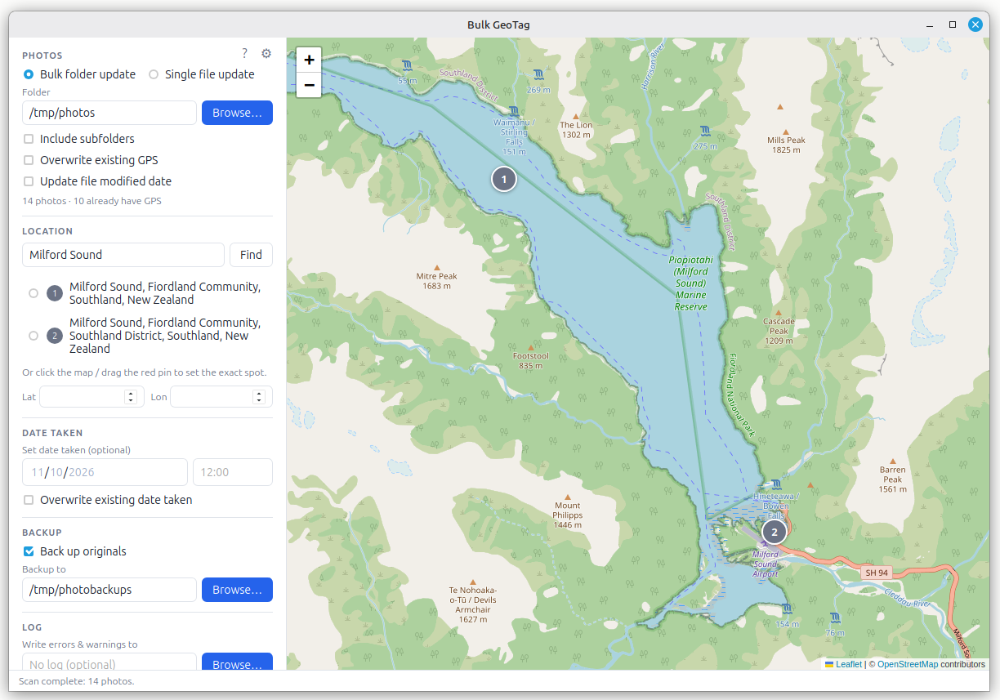

# Bulk GeoTag

A desktop app for adding GPS location and/or a date taken to a whole folder of photos at once, or to a single photo.

Select a folder, type a place name (or click the map), confirm the spot, optionally set a date taken, and Bulk GeoTag writes them into every photo's EXIF data. It can back up the originals first and log anything it had to skip.



Built with [Tauri 2](https://tauri.app) (Rust) and [Svelte](https://svelte.dev), with maps and place search from [OpenStreetMap](https://www.openstreetmap.org).

## Features

- **Two modes**: *Bulk folder update* or *Single file update*. Single-file mode shows the photo, its current GPS (grey pin) and date taken, and pre-fills them ready to adjust.
- **Folder scan**: counts photos and shows how many already have GPS. Can include subfolders (any depth).
- **Place search**: type a name such as *Colosseum, Rome* and pick from up to 5 matches, or click/drag the pin to an exact spot. Coordinates can also be typed in.
- **Date taken** (optional): set one date and time for every photo, with its own *overwrite existing* option. Can be used with or without a location.
- **Preview**: a dry run that lists what would happen to every photo, without changing anything.
- **Safe writing**: each photo is written to a temporary copy, checked, and only then swapped in. Camera data (make, model, orientation) is kept, and the date taken is only changed if you set one. The EXIF *Modified* stamp is set to the time of the change. The file's modified date is kept by default. Tick *Update file modified date* to change it, so OneDrive and other sync tools upload the tagged photos.
- **Optional backups**: originals are copied first into a backup folder that mirrors their full path.
- **Optional CSV log**: errors and warnings (skipped files, backup notices) go to a timestamped log file.
- **⚙ Settings**: contact email, Nominatim server, search language, results per search, clear the search cache.
- **Remembers** the last mode, the photo, backup and log folders, and the map position.

| Format | Read GPS | Write GPS |
|---|---|---|
| JPEG (`.jpg`, `.jpeg`) | ✓ | ✓ |
| TIFF (`.tif`, `.tiff`) | ✓ | ✓ |
| WebP (`.webp`) | ✓ | ✓ |
| PNG (`.png`) | ✓ | skipped and logged (not supported yet) |

## Installing

Download the latest package from the **[Releases page](https://github.com/ZuluPilgrim/bulk-geotag/releases/latest)**, then:

| System | File | Command |
|---|---|---|
| Mint / Ubuntu / Debian | `bulk-geotag_<version>_amd64.deb` | `sudo apt install ./bulk-geotag_<version>_amd64.deb` |
| Fedora / openSUSE | `bulk-geotag-<version>-1.x86_64.rpm` | `sudo dnf install ./bulk-geotag-<version>-1.x86_64.rpm` |
| Any distro, no install | `bulk-geotag_<version>_amd64.AppImage` | `chmod +x bulk-geotag_*.AppImage` then run it |
| Windows 10 / 11 | `bulk-geotag_<version>_x64-setup.exe` (or the `.msi`) | Run it. The installers are unsigned, so if SmartScreen says *"Windows protected your PC"*, click **More info → Run anyway**. |
| macOS 10.15+ (Apple Silicon and Intel) — **untested** | `bulk-geotag_<version>_universal.dmg` | Open the `.dmg` and drag *Bulk GeoTag* to Applications. See the macOS note below. |

> **Windows installers are unsigned.** They aren't code-signed (that needs a paid certificate), so Microsoft Defender SmartScreen shows *"Windows protected your PC"* the first time. Click **More info → Run anyway**. The installers are built by GitHub Actions from this repository; check a download against `SHA256SUMS.txt` (below) if you want to be sure it's untouched.

> **macOS: not tested yet.** The macOS build is produced automatically by GitHub Actions, but it **has not been tested on a Mac** because no Mac hardware was available. It may work fine, or it may not; reports are welcome. It is also **not signed or notarised by Apple** (that needs a paid Apple Developer account), so macOS will refuse to open it at first, sometimes saying the app *"is damaged"*. To allow it, either right-click the app in Applications → **Open** → **Open**, or run once in Terminal:
> ```bash
> xattr -cr "/Applications/Bulk GeoTag.app"
> ```

Check the download with `sha256sum -c SHA256SUMS.txt --ignore-missing` (the `SHA256SUMS.txt` file is attached to each release). On Windows: `Get-FileHash .\bulk-geotag_<version>_x64-setup.exe` in PowerShell, and compare with the file.

On Linux the app appears in the menu under **Graphics** as *Bulk GeoTag*; the terminal command is `bulk-geotag`. Remove it with `sudo apt remove bulk-geotag`. On Windows it's in the Start menu; remove it from *Settings → Apps*. On macOS it's in Applications; remove it by moving *Bulk GeoTag* to the Bin.

To build the packages yourself instead, see *Building packages* below.

## Documentation

- [User Guide](docs/USER_GUIDE.md): how to use the app
- [Architecture](docs/ARCHITECTURE.md): how it is built, for developers
- [Changelog](CHANGELOG.md): what changed in each version
- [Releasing](docs/RELEASING.md): step-by-step guide to publishing a new version
- [Release Claude Skill](docs/Bulk_Geotag_release_claude_skill.md): the same process as a Claude Skill (`bulk-geotag-release`)
- [Development time](docs/DEVELOPMENT_TIME.md): how long it took to build, start to finish

## Quick start (development)

Prerequisites on Ubuntu / Debian / Linux Mint 22+:

```bash
sudo apt install -y libwebkit2gtk-4.1-dev build-essential curl wget file \
  libxdo-dev libssl-dev libayatana-appindicator3-dev librsvg2-dev
curl --proto '=https' --tlsv1.2 -sSf https://sh.rustup.rs | sh -s -- -y   # Rust
# Node.js LTS, e.g. via nvm: https://github.com/nvm-sh/nvm
```

Run:

```bash
npm install
npm run tauri dev
```

Tests:

```bash
npm run check                       # TypeScript / Svelte
cd src-tauri && cargo test --lib    # Rust unit tests
```

For other platforms, see the [Tauri prerequisites](https://tauri.app/start/prerequisites/).

## Building packages

```bash
npm run tauri build
```

Takes ~5–10 minutes. Output in `src-tauri/target/release/bundle/`: `deb/`, `rpm/` and `appimage/`.

**Windows installers** are built by GitHub Actions (`.github/workflows/release-windows.yml`) on Windows runners: automatically when a `v*` tag is pushed, or by hand with `gh workflow run "Release (Windows)" -f tag=<tag>`. The `.msi` and `setup.exe` are attached to that tag's release and renamed to `bulk-geotag_…`. A first run takes ~17 min; later runs reuse the Rust cache.

**macOS** works the same way (`.github/workflows/release-macos.yml`, `gh workflow run "Release (macOS)" -f tag=<tag>`): one universal `.dmg` for Apple Silicon and Intel, ~10 min. **Not tested on a Mac.** After the Windows and macOS runs, regenerate `SHA256SUMS.txt` so it covers every file.

For the full release process (version bump, tags, Windows/macOS builds, checksums, notes) see **[docs/RELEASING.md](docs/RELEASING.md)**. In short, to publish the Linux packages to a release (renamed without spaces, plus checksums):

```bash
V=1.2.0; TAG=v1.2-packaged; B=src-tauri/target/release/bundle
mkdir -p /tmp/bgrel && rm -f /tmp/bgrel/*
cp "$B/deb/Bulk GeoTag_${V}_amd64.deb"           /tmp/bgrel/bulk-geotag_${V}_amd64.deb
cp "$B/rpm/Bulk GeoTag-${V}-1.x86_64.rpm"        /tmp/bgrel/bulk-geotag-${V}-1.x86_64.rpm
cp "$B/appimage/Bulk GeoTag_${V}_amd64.AppImage" /tmp/bgrel/bulk-geotag_${V}_amd64.AppImage
(cd /tmp/bgrel && sha256sum bulk-geotag* > SHA256SUMS.txt)
gh release create "$TAG" /tmp/bgrel/* --title "Bulk GeoTag $V" --notes "See CHANGELOG.md."
```

To change the icon, edit `app-icon.svg`, then:

```bash
rsvg-convert -w 1024 -h 1024 app-icon.svg -o app-icon.png
npm run tauri icon app-icon.png
```

## Licence

[MIT](LICENSE) © 2026 André Basel. Free to use, copy, modify and share, including commercially, as long as the copyright notice is kept.

## Credits

- Map data and place search © [OpenStreetMap contributors](https://www.openstreetmap.org/copyright), via the [Nominatim](https://nominatim.org) service. The app follows the [Nominatim usage policy](https://operations.osmfoundation.org/policies/nominatim/).
- Maps drawn with [Leaflet](https://leafletjs.com).
- EXIF reading: [kamadak-exif](https://crates.io/crates/kamadak-exif). EXIF writing: [little_exif](https://crates.io/crates/little_exif).
