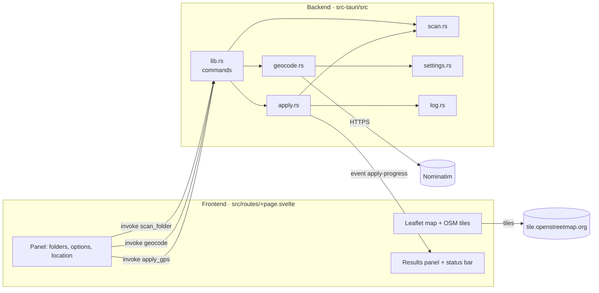

# Bulk GeoTag: Architecture

This document explains how the app is put together, so you can change it safely.

## Overview

Bulk GeoTag is a [Tauri 2](https://tauri.app) desktop app:

- the **frontend** is a single Svelte 5 page (SvelteKit in static/SPA mode) running in the system web view. It handles the UI, the Leaflet map and remembered settings.
- the **backend** is Rust. It handles everything that touches files or the network: scanning, place search, writing EXIF, backups and logging.

The frontend never touches the file system or network directly. It calls Rust **commands** through Tauri's `invoke()`, and receives **events** for progress.



## Repository layout

```
bulk-geotag/
├── README.md
├── docs/
│   ├── USER_GUIDE.md            ← also shown in the app by ? Help
│   ├── images/                  ← pictures for the docs (built into the app too)
│   └── ARCHITECTURE.md          ← this file
├── package.json                 ← frontend deps + scripts (npm run tauri dev)
├── svelte.config.js             ← adapter-static; css: "injected" (see Gotchas)
├── vite.config.js               ← Tauri dev-server settings (port 1420)
├── src/
│   ├── app.html
│   ├── lib/
│   │   ├── Inspector.svelte     ← 🖼 Inspector: gallery, breadcrumb, mini map, keys
│   │   ├── ExifDetails.svelte   ← the EXIF list (map card and Inspector)
│   │   └── types.ts             ← PhotoDetails
│   └── routes/
│       ├── +layout.ts           ← ssr = false (SPA)
│       └── +page.svelte         ← the main screen
└── src-tauri/
    ├── Cargo.toml               ← Rust deps
    ├── tauri.conf.json          ← window size/title, identifier, bundling
    ├── capabilities/default.json← permissions granted to the UI (dialog:default, …)
    └── src/
        ├── main.rs              ← entry point → lib::run()
        ├── lib.rs               ← registers plugins, state and commands
        ├── scan.rs              ← folder walk (or single file) + "has GPS / date?" detection
        ├── inspect.rs           ← single-file mode: current GPS, date, camera, preview
        ├── browse.rs            ← Inspector: one folder's subfolders + photos
        ├── thumbs.rs            ← Inspector thumbnails: embedded → cache → generated (image crate)
        ├── geocode.rs           ← Nominatim client: rate limit, cache, User-Agent
        ├── settings.rs          ← settings.json (server URL, contact email, language, results) + validation
        ├── apply.rs             ← Preview / Apply: backups, safe write, verify
        └── log.rs               ← CSV log writer
```

## Commands (frontend → Rust)

| Command | Arguments | Returns | Notes |
|---|---|---|---|
| `scan_folder` | `path`, `recursive` | `ScanResult` | Runs on a blocking thread. Read-only. |
| `geocode` | `query` | `Candidate[]` | Re-reads `settings.json` each call. Cached. Rate-limited. |
| `apply_gps` | `request: ApplyRequest` | `ApplyResult` | `dryRun: true` = Preview. Emits `apply-progress`. `root` may be a folder or one file. |
| `inspect_photo` | `path` | `PhotoDetails` | Single-file mode. Read-only. Runs on a blocking thread. |
| `path_kind` | `path` | `"folder" \| "photo" \| "other" \| "missing"` | Drag and drop: what a dropped path is. `photo` = `scan::is_supported` (PNG included; the UI then applies its writable-extension rule). |
| `get_settings` | none | `SettingsView` | For the ⚙ dialog: settings, settings.json path, cache size, default server. Creates the file if missing. |
| `save_settings` | `settings` | `Settings` | Validates and tidies (URL scheme, language codes, 1–10 results), writes settings.json, returns what was saved. |
| `clear_search_cache` | none | number removed | Empties the geocode cache in memory and on disk. |
| `list_folder` | `path` | `FolderListing` | Inspector. One folder (a file lists its folder): subfolders then photos, A–Z ignoring case, hidden left out, symlinks followed and marked `linked`, broken links left out. `parent` is None at `/` or a drive root. |
| `photo_thumbnail` | `path`, `large?` | `Thumb \| null` | Inspector. Embedded EXIF thumbnail (small tiles only), else cached/generated JPEG: 256 px, or 768 px when `large`. Blocking thread. |
| `clear_thumbnail_cache` | none | number removed | Deletes `thumbs/*.jpg` in the app cache folder. `get_settings` also returns `cache_thumbnails`. |

**Event:** `apply-progress` with payload `[done, total]`, emitted once per photo during Preview and Apply.

Key types (Rust → JSON):

```text
ScanResult   { photos, with_gps, unreadable, files: PhotoInfo[], folder_errors: PhotoInfo[] }
PhotoInfo    { path, gps: "present" | "absent" | "unreadable", has_date, issue }
Candidate    { label, lat, lon }
FolderListing{ path, parent?, folders: Item[], photos: Item[] }      Item { name, path, linked }
Thumb        { data (data:image/jpeg;base64), orientation 1–8, embedded }
PhotoDetails { path, name, lat?, lon?, date_taken? ("YYYY-MM-DD HH:MM:SS"), camera?, lens?, exposure? ("1/250 s"), aperture? ("f/2.8"),
               iso?, focal_length? ("35 mm (53 mm equiv.)"), dimensions? ("6240 × 4160"), software?, orientation, preview? (data: URL),
               preview_is_thumbnail, issue? }
ApplyRequest { root, recursive, overwrite, lat?, lon?, dateTaken?, overwriteDate = false, backupDir?, logDir?, dryRun, updateModified = false }   (camelCase in)
ApplyResult  { dry_run, total, written, skipped, warnings, errors, entries: Entry[], log_file?, log_error? }
Entry        { time, level: "info" | "warning" | "error", path, message }
```

## Modules

### `scan.rs`: finding photos
- If `root` is a **file** (single-file mode), returns just that photo; it must have a supported extension.
- `walkdir`, with `follow_links(false)`. `max_depth` is 1 unless subfolders are on.
- Skips hidden entries (names starting with `.`) at any depth below the selected folder.
- Extensions: `jpg jpeg png tif tiff webp`, case-insensitive.
- GPS and date detection use **kamadak-exif**. `has_date` is true when `DateTimeOriginal` exists. GPS is *present* when both `GPSLatitude` and `GPSLongitude` exist. "No EXIF at all" counts as *absent*, not an error. Any other parse failure counts as *unreadable*.
- Folders that can't be opened go in `folder_errors` and aren't counted as photos.

### `geocode.rs` + `settings.rs`: place search
Built around the [Nominatim usage policy](https://operations.osmfoundation.org/policies/nominatim/):

| Policy requirement | Implementation |
|---|---|
| Identify the application | `User-Agent: bulk-geotag/<version> (+<repo URL>; <contact_email>)`, plus `email=` parameter when set |
| Max 1 request/second (app-wide) | `reserve_slot()` spaces requests ≥ 1.1 s apart, queuing if needed |
| No autocomplete | UI calls `geocode` only on Enter or Find |
| Cache results | JSON cache in the app cache folder, keyed by server + language + limit + normalised query |
| Server switchable without an update | `nominatim_url` in `settings.json`, editable in ⚙ Settings |

Requests: `GET {url}/search?q=…&format=jsonv2&limit=5&accept-language=en`, using `reqwest` with rustls (no system OpenSSL needed). HTTP 403 and 429 are turned into readable messages.

`settings.json` lives in Tauri's `app_config_dir()`. It is created with defaults on first use and re-read on every search. Fields: `nominatim_url`, `contact_email`, `language` (Nominatim `accept-language`, comma-separated codes, default `en`), `max_results` (1–10, default 5). `#[serde(default)]` fills fields missing from older files. Language and result count are part of the cache key.

### `apply.rs`: Preview and Apply
`run(request, progress)`:

1. **Validate:** lat/lon both set or both empty, and in range. `dateTaken` (HTML `datetime-local`, `YYYY-MM-DDTHH:MM[:SS]`) is converted to EXIF `YYYY:MM:DD HH:MM:SS`. At least one of location or date is required. The backup folder must exist and must not be inside the photo folder (compared after `canonicalize`).
2. **Rescan** with `scan::scan`, so the backend never trusts stale UI state.
3. For each photo, decide:
   - unreadable: **error**, skip
   - not a writable format (PNG): **warning**, skip
   - location set: GPS is written unless the photo has GPS and *overwrite* is off (**warning**)
   - date set: date is written unless the photo has a date taken and *overwriteDate* is off (**warning**)
   - nothing left to write for this photo: skip
   - otherwise: back up (if on), then write
4. **Backup:** `backup_target()` mirrors every `Normal` path component under the backup folder, dropping the root and drive prefix. The copy keeps the original's modified and accessed dates (`copy_file_dates`, because `fs::copy` only keeps permissions). An existing backup is kept (warning). A failed copy means the photo is skipped (error).
5. **Dry run** stops there and reports *will write GPS*.
6. **Write** with `tag_photo()` (below).
7. **Log:** when not a dry run and a log folder is set, `log::write_log` writes warnings and errors.

`tag_photo(path, lat, lon)`, the safe-write sequence:

```text
read original EXIF (kamadak)      → error if unparseable; remember Make/Model/Orientation and DateTimeOriginal
copy  photo → .<stem>.bulkgeotag-tmp.<ext>   (same folder; hidden; keeps extension for format detection)
load  EXIF from temp (little_exif) — or empty Metadata if the file had no EXIF
if location: set GPSVersionID 2.3, Lat/LatRef, Lon/LonRef  (DMS rationals, seconds to 1/10000)
if date:     set DateTimeOriginal + CreateDate
always:      set ModifyDate (EXIF DateTime) = now
write EXIF into temp
verify: re-read temp → coordinates within 1e-5°; DateTimeOriginal + DateTimeDigitized equal the new date
        (or DateTimeOriginal unchanged if no date was set); DateTime = now; Make/Model/Orientation unchanged
if !updateModified: restore original modified/accessed times on temp (std FileTimes)
                  else: leave them as "now" so sync tools (OneDrive, rsync…) see the change
rename temp → original           (atomic replace on the same filesystem)
on any failure: delete temp, original untouched
```

### `inspect.rs`: single-file details
- Reads GPS (`read_coord`), Date Taken (`DateTimeOriginal`), Make/Model and Orientation with kamadak-exif.
- Shooting details for the map card, formatted in Rust: `LensModel`, `ExposureTime` (`1/N s` below a second), `FNumber`, `PhotographicSensitivity` (ISO), `FocalLength` plus `FocalLengthIn35mmFilm` when it differs, `PixelX/YDimension` (falling back to `ImageWidth/Length`) and `Software`. Missing or zero values stay `None`. Tested against `test-data/exif-details.jpg`.
- **Preview:** JPEG/WebP/PNG up to 25 MB are sent whole as a base64 `data:` URL (the web view applies EXIF orientation itself). Otherwise — TIFF or larger files — the EXIF **embedded thumbnail** (IFD1 `JPEGInterchangeFormat`) is used if present, and the UI rotates it from `orientation`.
- In `apply.rs`, the backup-inside-photo-folder rule uses the file's **parent** folder in single-file mode.

### `browse.rs` + `thumbs.rs`: the Inspector
- `list_folder` reads one directory with `read_dir`. `file_type()` doesn't follow links, so a symlink is classified by `fs::metadata` (followed); browsing one folder at a time can't loop. These listings are **display only**: `scan.rs` still skips linked entries, and refuses a linked single photo (writing through a temp file + rename would replace the link).
- Thumbnails: `embedded_thumbnail()` from `inspect.rs` when not `large`; otherwise `thumbs/<fnv1a(path|size|mtime)>-<px>.jpg` in the app cache dir, else decode with `image` (jpeg/png/webp/tiff, no default features), `thumbnail(px, px)`, JPEG q80, write via `.tmp` + rename. Orientation is returned, not applied; the UI rotates with CSS.
- `Cargo.toml` sets `[profile.dev.package."*"] opt-level = 2`: unoptimised image decoding is ~10× slower in `tauri dev`.

### `log.rs`: CSV log
- Name `bulk-geotag_%Y-%m-%d_%H-%M-%S.csv`, from the local start time of the run (chrono).
- Opened in append mode. The header row is written only if the file is empty.
- Only `warning` and `error` entries are written. No file is created when there are none.
- Fields containing `,` `"` or newlines are quoted, RFC 4180 style.

### Frontend: `+page.svelte`
- Svelte 5 runes (`$state`, `$derived`, `$effect`).
- **Scan:** an `$effect` reruns `scan_folder` when the folder or the subfolder option changes. A sequence number discards out-of-date results.
- **Apply count** is worked out in the UI from the scan results: writable extension, not unreadable, and (overwrite or no GPS). It matches the backend's rules.
- **Map:** Leaflet with OSM tiles. Markers are `divIcon`s, so there are no image assets to bundle. Clicking the map or dragging the pin sets lat/lon to 6 decimal places.
- **Update file modified date** (`updateModified`) defaults to `false` in the UI and is not remembered. On the Rust side it is `#[serde(default)]`, so false when omitted.
- **Dialogs:** `@tauri-apps/plugin-dialog`, with `open({directory:true})` for folders and `ask()` for the Apply confirmation. These are the system's own pickers (GTK on Linux, which has no thumbnail view).
- **Drag and drop:** `getCurrentWebview().onDragDropEvent` (Tauri's native file drop; `dragDropEnabled` is on by default, and `core:default` allows the events). `enter`/`over` show the `.drop-hint` overlay. On `drop`, exactly one path is accepted; `path_kind` decides: folder → `setMode("bulk")` + `folder`, photo with a writable extension → `setMode("single")` + `filePath` + `loadDetails(true)`, anything else → a status message. Ignored while `busy` or a dialog is open.
- **Inspector** (`src/lib/Inspector.svelte`): mounted as a `position: fixed` overlay (z-index 1500, under the Help/Settings modals at 2000) while `inspectorOpen`. Thumbnails: an `IntersectionObserver` (action `lazy`) tracks tiles near the view; a queue fetches at most 4 at a time, keyed `S|path` / `L|path` (large from tile ≥ 200 px), showing the other size while one loads. Its own Leaflet map shows the selected photo's pin. Keys: the page's `onKey` calls `inspector.handleKey(e)` first (unless a dialog is open); ↑ ↓ pick the nearest item in the row above/below by `getBoundingClientRect`, so they work across the wrapped folder buttons and the photo grid. `result()` returns the folder on screen, the photo the user picked (not an automatic selection) and its GPS; `closeInspector()` applies it per mode.
- **Photo details card:** single-file mode shows `details` in `.exif-card`, absolutely positioned top-right over the map (z-index 900, below Results and dialogs). `exifRows` drops empty values; ▾/▸ toggles `exifCollapsed`, which is remembered.
- **Mode:** `mode` is `"bulk" | "single"`; `root` is the folder or the file. In single mode, `inspect_photo` fills `details`, pre-fills lat/lon and date, and `atCurrent` (pin within 1e-5° of the photo's GPS) drives the pin colour: grey `at-current` while there, red once moved, plus a non-interactive grey `currentMarker` at the photo's GPS.
- **Settings dialog:** ⚙ button (`.gear`) opens a modal; `get_settings` fills a `draft`, Save calls `save_settings` and shows Rust's validation message on failure. *Show in folder* uses `revealItemInDir` from `@tauri-apps/plugin-opener` (allowed by `opener:default`).
- **? Help:** `docs/USER_GUIDE.md` is imported with Vite's `?raw`, so its text is built into the app at build time (no Tauri resource, no Rust command, works offline). `marked` with `marked-gfm-heading-id` turns it into HTML once, with GitHub-style heading ids so the guide's Contents links match. Pictures in `docs/images/` are imported with `import.meta.glob(…, { query: "?url" })`, and a `walkTokens` hook points the guide's `images/…` links at the built-in copies. The HTML is shown with `{@html}` (safe: it comes only from our own file at build time) in a `.modal.help`; its styles use `.help-body :global(…)`. One click handler on the body scrolls `#anchor` links within the panel and opens anything else with `openUrl` (relative links go to the file on GitHub). `?` (`.corner-buttons`, next to ⚙) or F1 opens it; Esc closes Help first, then Settings.
- **Remembered settings:** `localStorage` key `bulk-geotag.settings.v1` holds the mode, folder, backup on/off, backup folder, log folder, map centre/zoom and whether the details card is folded. Every access is wrapped in try/catch.

## Dependencies

| Crate / package | Used for |
|---|---|
| `tauri` 2, `tauri-plugin-dialog`, `tauri-plugin-opener` | App shell, native folder chooser |
| `walkdir` | Folder traversal |
| `kamadak-exif` | Reading EXIF (detection + verification) |
| `little_exif` | Writing EXIF (GPS, dates) into JPEG / TIFF / WebP |
| `reqwest` (rustls) | HTTPS to Nominatim |
| `serde`, `serde_json` | Command payloads, settings, cache |
| `chrono` | Local time for log names and lines |
| `base64` | Preview images for single-file mode and Inspector thumbnails |
| `image` (jpeg, png, webp, tiff) | Making Inspector thumbnails |
| `leaflet` | Map |
| `marked`, `marked-gfm-heading-id` | User Guide → HTML for ? Help |
| `svelte`, `@sveltejs/kit`, `adapter-static`, `vite` | Frontend |

## Testing

```bash
npm run check                       # svelte-check + TypeScript
npm run check:guide                 # User Guide: Contents links and images
cd src-tauri && cargo test --lib    # 15 unit tests
```

| Test | Covers |
|---|---|
| `apply::backup_mirrors_full_path` | Backup path mirroring |
| `apply::backup_copy_keeps_dates` | Backup copies keep the original modified date |
| `apply::exif_date_from_ui_input` | Date picker value → EXIF date format |
| `apply::dms_round_trip` | Decimal → degrees/minutes/seconds accuracy |
| `apply::temp_keeps_extension_and_is_hidden` | Temp file naming |
| `geocode::parses_nominatim_json` | Response parsing, bad rows dropped |
| `geocode::cache_key_normalises_query` | Case and whitespace don't affect caching |
| `geocode::user_agent_includes_email_when_set` | User-Agent format |
| `geocode::rate_limit_spaces_requests` | ≥ 1 s spacing, queuing |
| `log::escapes_csv` | CSV quoting |
| `settings::language_codes` | Language code tidy-up and rejection |
| `settings::validation` | URL scheme, results range, blank server → default |
| `settings::old_files_get_new_defaults` | v1.1 settings.json still loads |
| `geocode::cache_key_includes_language_and_limit` | Changing language/limit doesn't reuse old results |
| `geocode::clear_cache_empties_it` | Clear cache removes memory and file |

**Manual check** after changing write code: run Apply on a folder of copies, then compare with ExifTool:

```bash
exiftool -q -T -FileName -GPSPosition -Make -Model -DateTimeOriginal *.JPG
ls -la --time-style=+'%F %T'
```

## Packaging

`npm run tauri build` produces `.deb`, `.rpm` and AppImage (`bundle.targets` in `tauri.conf.json`) under `src-tauri/target/release/bundle/`.

- `productName` "Bulk GeoTag" is the menu/installer name; `mainBinaryName` keeps the command as `bulk-geotag`.
- `bundle.category` "Photography" → *Graphics* in desktop menus. Descriptions, publisher and homepage feed package managers.
- Icons: `app-icon.svg` (source) → `app-icon.png` (1024²) → `npm run tauri icon app-icon.png` regenerates everything in `src-tauri/icons/`.
- **Windows**: `.github/workflows/release-windows.yml` runs on `windows-latest` (on `v*` tags, or `workflow_dispatch` with a tag), builds `--bundles msi,nsis` with `tauri-apps/tauri-action`, uploads to the tag's release. GitHub turns the space in "Bulk GeoTag" into a dot, so a final workflow step renames the assets `Bulk.GeoTag_*` → `bulk-geotag_*` (`gh api -X PATCH …/releases/assets/<id>`). Uses the same app code; settings live in `%APPDATA%\com.zulupilgrim.bulkgeotag\`. The app runs on WebView2 (built into Windows 10/11; the installer fetches it if missing). Installers are unsigned. `SHA256SUMS.txt` is regenerated by hand after the run (see README).
- **macOS** (**untested on a Mac: no hardware available**): `.github/workflows/release-macos.yml` runs on `macos-latest`, adds both Rust targets (`aarch64-apple-darwin`, `x86_64-apple-darwin`) and builds `--target universal-apple-darwin --bundles app,dmg`, giving one universal `.dmg`. A final step renames `Bulk.GeoTag_*` → `bulk-geotag_*` and deletes the `.app.tar.gz` (only used by Tauri's updater, which isn't enabled). First run ~10 min. Not signed or notarised, so Gatekeeper quarantines it: users run `xattr -cr "/Applications/Bulk GeoTag.app"` or right-click → Open. Settings would live in `~/Library/Application Support/com.zulupilgrim.bulkgeotag/`.
- The AppImage (~89 MB) bundles WebKitGTK; the `.deb`/`.rpm` (~4.6 MB) depend on the system's `libwebkit2gtk-4.1`.
- The installed app's web view has a different origin from `tauri dev`, so remembered folders/map position are separate; `settings.json` is shared (same identifier).

## Gotchas

- **Dev-mode CSS:** with Vite 8 and vite-plugin-svelte 7, component styles were delivered incorrectly in dev, which lost the CSS variables and `:global` rules. `svelte.config.js` sets `compilerOptions: { css: "injected" }` to work around it. Don't remove it without re-testing `npm run tauri dev`.
- **little_exif and PNG:** it writes PNG EXIF as an ImageMagick-style `zTXt` "Raw profile type exif" chunk rather than the standard `eXIf` chunk, and kamadak-exif doesn't read that chunk. So PNG is excluded from writing in `apply::writable()` and in the UI's `WRITABLE` regex. Change both together.
- **little_exif needs the file extension** to detect the format, which is why the temp file keeps it.
- **TIFFs without `XResolution`** are refused by little_exif. Real camera and scanner TIFFs have it.
- **Folder chooser button label:** rfd (behind the dialog plugin) doesn't pass an accept label to the xdg portal, so Linux shows "Open". Titles say "Select …".
- **Renaming a User Guide heading** changes its id and breaks Contents links (and any `openHelp("…")` call) that point at it. Run `npm run check:guide` after editing the guide.
- **Separate storage:** the dev server (`http://localhost:1420`) and the bundled app have different web-view origins, so their `localStorage` (remembered settings) is separate.

## Ideas / roadmap

- PNG: write a standard `eXIf` chunk directly.
- HEIC/HEIF: little_exif supports it; it needs testing and adding to the extension lists.
- Altitude and direction tags.
- Date taken: shift by an offset, or a time-zone tag (OffsetTimeOriginal).
- Test the macOS build on real hardware; Apple signing and notarisation.
- Code-signing for the Windows installers (removes the SmartScreen warning).
