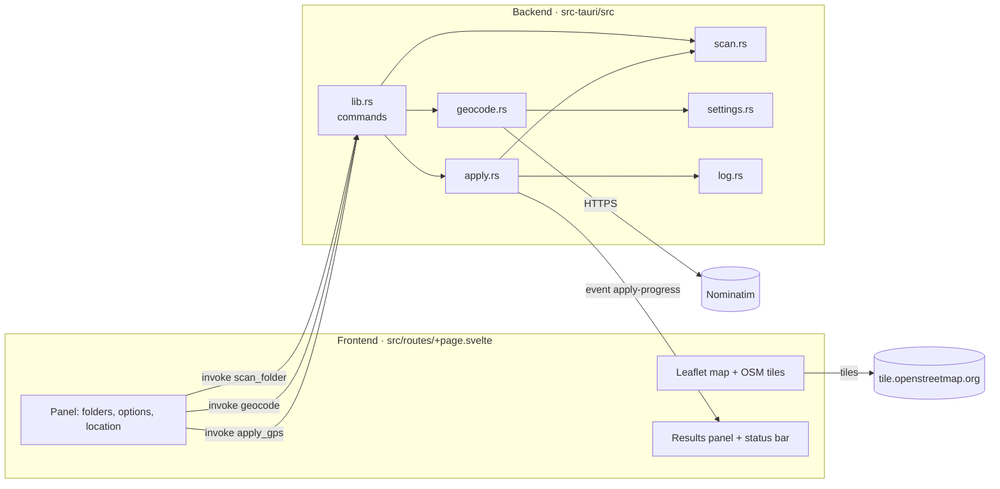

# Bulk GeoTag: Architecture

This document explains how the app is put together, so you can change it safely.

## Overview

Bulk GeoTag is a [Tauri 2](https://tauri.app) desktop app:

- the **frontend** is a single Svelte 5 page (SvelteKit in static/SPA mode) running in the system web view. It handles the UI, the Leaflet map and remembered settings.
- the **backend** is Rust. It handles everything that touches files or the network: scanning, place search, writing EXIF, backups and logging.

The frontend never touches the file system or network directly. It calls Rust **commands** through Tauri's `invoke()`, and receives **events** for progress.



## Repository layout

```
bulk-geotag/
├── README.md
├── docs/
│   ├── USER_GUIDE.md
│   └── ARCHITECTURE.md          ← this file
├── package.json                 ← frontend deps + scripts (npm run tauri dev)
├── svelte.config.js             ← adapter-static; css: "injected" (see Gotchas)
├── vite.config.js               ← Tauri dev-server settings (port 1420)
├── src/
│   ├── app.html
│   └── routes/
│       ├── +layout.ts           ← ssr = false (SPA)
│       └── +page.svelte         ← the whole UI
└── src-tauri/
    ├── Cargo.toml               ← Rust deps
    ├── tauri.conf.json          ← window size/title, identifier, bundling
    ├── capabilities/default.json← permissions granted to the UI (dialog:default, …)
    └── src/
        ├── main.rs              ← entry point → lib::run()
        ├── lib.rs               ← registers plugins, state and commands
        ├── scan.rs              ← folder walk + "has GPS?" detection
        ├── geocode.rs           ← Nominatim client: rate limit, cache, User-Agent
        ├── settings.rs          ← settings.json (server URL, contact email)
        ├── apply.rs             ← Preview / Apply: backups, safe write, verify
        └── log.rs               ← CSV log writer
```

## Commands (frontend → Rust)

| Command | Arguments | Returns | Notes |
|---|---|---|---|
| `scan_folder` | `path`, `recursive` | `ScanResult` | Runs on a blocking thread. Read-only. |
| `geocode` | `query` | `Candidate[]` | Re-reads `settings.json` each call. Cached. Rate-limited. |
| `apply_gps` | `request: ApplyRequest` | `ApplyResult` | `dryRun: true` = Preview. Emits `apply-progress`. |
| `settings_location` | none | path string | Creates settings.json if missing. Not used by the UI yet. |

**Event:** `apply-progress` with payload `[done, total]`, emitted once per photo during Preview and Apply.

Key types (Rust → JSON):

```text
ScanResult   { photos, with_gps, unreadable, files: PhotoInfo[], folder_errors: PhotoInfo[] }
PhotoInfo    { path, gps: "present" | "absent" | "unreadable", issue }
Candidate    { label, lat, lon }
ApplyRequest { root, recursive, overwrite, lat, lon, backupDir?, logDir?, dryRun, updateModified = false }   (camelCase in)
ApplyResult  { dry_run, total, written, skipped, warnings, errors, entries: Entry[], log_file?, log_error? }
Entry        { time, level: "info" | "warning" | "error", path, message }
```

## Modules

### `scan.rs`: finding photos
- `walkdir`, with `follow_links(false)`. `max_depth` is 1 unless subfolders are on.
- Skips hidden entries (names starting with `.`) at any depth below the selected folder.
- Extensions: `jpg jpeg png tif tiff webp`, case-insensitive.
- GPS detection uses **kamadak-exif**. GPS is *present* when both `GPSLatitude` and `GPSLongitude` exist. "No EXIF at all" counts as *absent*, not an error. Any other parse failure counts as *unreadable*.
- Folders that can't be opened go in `folder_errors` and aren't counted as photos.

### `geocode.rs` + `settings.rs`: place search
Built around the [Nominatim usage policy](https://operations.osmfoundation.org/policies/nominatim/):

| Policy requirement | Implementation |
|---|---|
| Identify the application | `User-Agent: bulk-geotag/<version> (+<repo URL>; <contact_email>)`, plus `email=` parameter when set |
| Max 1 request/second (app-wide) | `reserve_slot()` spaces requests ≥ 1.1 s apart, queuing if needed |
| No autocomplete | UI calls `geocode` only on Enter or Find |
| Cache results | JSON cache in the app cache folder, keyed by server + language + limit + normalised query |
| Server switchable without an update | `nominatim_url` in `settings.json` |

Requests: `GET {url}/search?q=…&format=jsonv2&limit=5&accept-language=en`, using `reqwest` with rustls (no system OpenSSL needed). HTTP 403 and 429 are turned into readable messages.

`settings.json` lives in Tauri's `app_config_dir()`. It is created with defaults on first use and re-read on every search.

### `apply.rs`: Preview and Apply
`run(request, progress)`:

1. **Validate:** lat/lon in range. The backup folder must exist and must not be inside the photo folder (compared after `canonicalize`).
2. **Rescan** with `scan::scan`, so the backend never trusts stale UI state.
3. For each photo, decide:
   - unreadable: **error**, skip
   - not a writable format (PNG): **warning**, skip
   - has GPS and not overwriting: **warning**, skip
   - otherwise: back up (if on), then write
4. **Backup:** `backup_target()` mirrors every `Normal` path component under the backup folder, dropping the root and drive prefix. The copy keeps the original's modified and accessed dates (`copy_file_dates`, because `fs::copy` only keeps permissions). An existing backup is kept (warning). A failed copy means the photo is skipped (error).
5. **Dry run** stops there and reports *will write GPS*.
6. **Write** with `tag_photo()` (below).
7. **Log:** when not a dry run and a log folder is set, `log::write_log` writes warnings and errors.

`tag_photo(path, lat, lon)`, the safe-write sequence:

```text
read original EXIF (kamadak)      → error if unparseable; remember Make/Model/DateTime/DateTimeOriginal/Orientation
copy  photo → .<stem>.bulkgeotag-tmp.<ext>   (same folder; hidden; keeps extension for format detection)
load  EXIF from temp (little_exif) — or empty Metadata if the file had no EXIF
set   GPSVersionID 2.3, Lat/LatRef, Lon/LonRef  (DMS rationals, seconds to 1/10000)
write EXIF into temp
verify: re-read temp → coordinates within 1e-5° AND the remembered camera tags unchanged
if !updateModified: restore original modified/accessed times on temp (std FileTimes)
                  else: leave them as "now" so sync tools (OneDrive, rsync…) see the change
rename temp → original           (atomic replace on the same filesystem)
on any failure: delete temp, original untouched
```

### `log.rs`: CSV log
- Name `bulk-geotag_%Y-%m-%d_%H-%M-%S.csv`, from the local start time of the run (chrono).
- Opened in append mode. The header row is written only if the file is empty.
- Only `warning` and `error` entries are written. No file is created when there are none.
- Fields containing `,` `"` or newlines are quoted, RFC 4180 style.

### Frontend: `+page.svelte`
- Svelte 5 runes (`$state`, `$derived`, `$effect`).
- **Scan:** an `$effect` reruns `scan_folder` when the folder or the subfolder option changes. A sequence number discards out-of-date results.
- **Apply count** is worked out in the UI from the scan results: writable extension, not unreadable, and (overwrite or no GPS). It matches the backend's rules.
- **Map:** Leaflet with OSM tiles. Markers are `divIcon`s, so there are no image assets to bundle. Clicking the map or dragging the pin sets lat/lon to 6 decimal places.
- **Update modified date** (`updateModified`) defaults to `false` in the UI and is not remembered. On the Rust side it is `#[serde(default)]`, so false when omitted.
- **Dialogs:** `@tauri-apps/plugin-dialog`, with `open({directory:true})` for folders and `ask()` for the Apply confirmation.
- **Remembered settings:** `localStorage` key `bulk-geotag.settings.v1` holds the folder, backup on/off, backup folder, log folder and map centre/zoom. Every access is wrapped in try/catch.

## Dependencies

| Crate / package | Used for |
|---|---|
| `tauri` 2, `tauri-plugin-dialog`, `tauri-plugin-opener` | App shell, native folder chooser |
| `walkdir` | Folder traversal |
| `kamadak-exif` | Reading EXIF (detection + verification) |
| `little_exif` | Writing EXIF into JPEG / TIFF / WebP |
| `reqwest` (rustls) | HTTPS to Nominatim |
| `serde`, `serde_json` | Command payloads, settings, cache |
| `chrono` | Local time for log names and lines |
| `leaflet` | Map |
| `svelte`, `@sveltejs/kit`, `adapter-static`, `vite` | Frontend |

## Testing

```bash
npm run check                       # svelte-check + TypeScript
cd src-tauri && cargo test --lib    # 9 unit tests
```

| Test | Covers |
|---|---|
| `apply::backup_mirrors_full_path` | Backup path mirroring |
| `apply::backup_copy_keeps_dates` | Backup copies keep the original modified date |
| `apply::dms_round_trip` | Decimal → degrees/minutes/seconds accuracy |
| `apply::temp_keeps_extension_and_is_hidden` | Temp file naming |
| `geocode::parses_nominatim_json` | Response parsing, bad rows dropped |
| `geocode::cache_key_normalises_query` | Case and whitespace don't affect caching |
| `geocode::user_agent_includes_email_when_set` | User-Agent format |
| `geocode::rate_limit_spaces_requests` | ≥ 1 s spacing, queuing |
| `log::escapes_csv` | CSV quoting |

**Manual check** after changing write code: run Apply on a folder of copies, then compare with ExifTool:

```bash
exiftool -q -T -FileName -GPSPosition -Make -Model -DateTimeOriginal *.JPG
ls -la --time-style=+'%F %T'
```

## Gotchas

- **Dev-mode CSS:** with Vite 8 and vite-plugin-svelte 7, component styles were delivered incorrectly in dev, which lost the CSS variables and `:global` rules. `svelte.config.js` sets `compilerOptions: { css: "injected" }` to work around it. Don't remove it without re-testing `npm run tauri dev`.
- **little_exif and PNG:** it writes PNG EXIF as an ImageMagick-style `zTXt` "Raw profile type exif" chunk rather than the standard `eXIf` chunk, and kamadak-exif doesn't read that chunk. So PNG is excluded from writing in `apply::writable()` and in the UI's `WRITABLE` regex. Change both together.
- **little_exif needs the file extension** to detect the format, which is why the temp file keeps it.
- **TIFFs without `XResolution`** are refused by little_exif. Real camera and scanner TIFFs have it.
- **Folder chooser button label:** rfd (behind the dialog plugin) doesn't pass an accept label to the xdg portal, so Linux shows "Open". Titles say "Select …".
- **Separate storage:** the dev server (`http://localhost:1420`) and the bundled app have different web-view origins, so their `localStorage` (remembered settings) is separate.

## Ideas / roadmap

- PNG: write a standard `eXIf` chunk directly.
- HEIC/HEIF: little_exif supports it; it needs testing and adding to the extension lists.
- Altitude and direction tags.
- A settings screen in the UI for `settings.json`.
- Packaging and release builds for Linux (`.deb`, AppImage), Windows and macOS.
